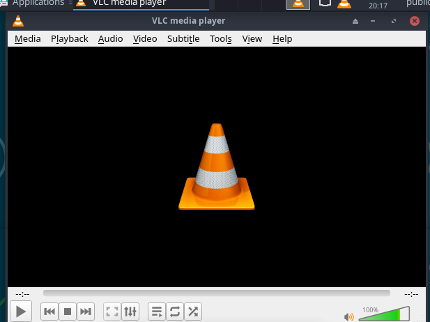

# 🇨🇱 Chile OS

### Linux con identidad chilena. Hecho en Chile para el mundo.

🐧 Basado en Debian · 🇨🇱 Proyecto independiente · 💻 32 y 64 bits (por verificar en cada ISO)

---

## 📖 ¿Qué es Chile OS?

Chile OS es un proyecto independiente de sistema operativo basado en Debian Linux, creado en Chile.

Su objetivo es ofrecer una alternativa para computadores, acercar Linux a más personas y desarrollar un sistema operativo con identidad propia.
## 🖥️ Capturas de Chile OS

### Escritorio principal

### VLC Media Player

## 🎯 Objetivos

- 🇨🇱 Crear un sistema operativo con identidad chilena.
- 🐧 Ofrecer una alternativa basada en Linux.
- 💻 Trabajar en compatibilidad con diferentes computadores.
- 🌎 Acercar Linux a más personas.
- 🚀 Mejorar el sistema mediante futuras versiones.

## ⚙️ Información del sistema

| Característica | Información |
|---|---|
| Nombre | Chile OS |
| Tipo | Sistema operativo |
| Base | Debian Linux |
| Kernel | Linux |
| Formato | ISO |
| País | Chile 🇨🇱 |
| Distribución | Proyecto independiente |
| Estado | En desarrollo |

## 📥 Descargas

Las descargas oficiales se publicarán cuando cada imagen ISO esté verificada.

[Consultar versiones](../../releases)

## 🚀 Instalación

### VirtualBox

1. Descarga una ISO verificada.
2. Abre VirtualBox.
3. Crea una máquina virtual.
4. Selecciona Debian como tipo de sistema.
5. Configura los recursos de la máquina.
6. Selecciona la ISO.
7. Inicia la máquina virtual.
8. Sigue las instrucciones de instalación.

### Computador físico

Antes de instalar, realiza una copia de seguridad de tus archivos y comprueba la compatibilidad del equipo.

## 🧪 Estado del proyecto

| Área | Estado |
|---|---|
| Proyecto | En desarrollo |
| Base Debian | Definida |
| Escritorio | Probado |
| VLC Media Player | Instalado |
| Terminal | Pendiente de documentar |
| Explorador de archivos | Pendiente de documentar |
| Documentación | En desarrollo |
| Descargas oficiales | Pendientes de verificar |

## 🤝 Cómo colaborar

Puedes ayudar a Chile OS mediante:

- Reportes de errores.
- Sugerencias.
- Pruebas del sistema.
- Ideas para futuras versiones.
- Mejoras de documentación.

## 🐛 Reportar problemas

Utiliza la sección Issues de GitHub.

Incluye la arquitectura, versión, descripción del problema y capturas si es posible.

## 🔮 Futuro de Chile OS

- Mejoras en el escritorio.
- Nuevas aplicaciones.
- Compatibilidad de hardware.
- Mejoras de rendimiento.
- Actualizaciones.
- Comunidad internacional.

## 📜 Licencias

La licencia del proyecto está pendiente de confirmación.

Debian y los componentes incluidos mantienen sus respectivas licencias originales.

---

## 🇨🇱 CHILE OS

**Linux con identidad chilena.**

Hecho con pasión por la informática y el software libre.

🐧 ¡Gracias por apoyar Chile OS!
