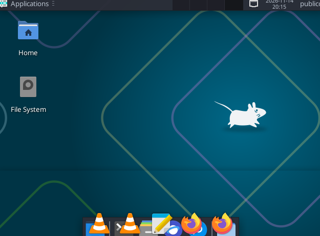

# 🇨🇱 Chile OS

### Una distribución Linux con identidad chilena.

  <strong>Un proyecto independiente creado en Chile 🇨🇱</strong>
   
  Basado en Debian · Linux · Tecnología

  
  
  
  

---

## 🖥️ ¿Qué es Chile OS?

**Chile OS** es una distribución Linux independiente basada en Debian, creada con el objetivo de desarrollar una experiencia de escritorio con identidad chilena.

Este proyecto nace de la curiosidad por Linux, la informática y la creación de sistemas operativos.

Queremos demostrar que desde Chile también se pueden crear proyectos tecnológicos propios.

## 📸 Capturas de pantalla

### 🖥️ Escritorio

La interfaz principal de Chile OS.

### 💻 Terminal

La terminal de comandos del sistema.

### 📁 Archivos

El administrador de archivos de Chile OS.

---

## ✨ Características

- 🇨🇱 Identidad visual chilena.
- 🐧 Basado en Debian.
- 🖥️ Entorno de escritorio Linux.
- 💻 Terminal para trabajar con comandos.
- 📁 Administrador de archivos.
- 💿 Distribución mediante imagen ISO.
- 🧪 Compatible con pruebas en máquinas virtuales como VirtualBox.

## 📥 Descargar Chile OS

<strong>🇨🇱 DESCARGAR CHILE OS</strong>

La imagen ISO está alojada en Google Drive.

### 👉 [DESCARGAR CHILE OS (ISO)](https://drive.google.com/file/d/1g0ntbJqmx5qxyToApAhjKGmK_SAw38yq/view?usp=sharing)

## 🚀 Cómo probar Chile OS

Puedes probar Chile OS utilizando VirtualBox.

1. Descarga la imagen ISO.
2. Abre VirtualBox.
3. Crea una máquina virtual compatible.
4. Selecciona la ISO de Chile OS.
5. Inicia la máquina virtual.
6. ¡Explora el sistema!

**Recomendación:** prueba el sistema en una máquina virtual antes de utilizarlo en un equipo físico.

## 🛠️ Tecnologías

| Tecnología | Uso |
|---|---|
| Debian | Sistema base |
| Linux | Kernel y entorno del sistema |
| VirtualBox | Pruebas virtuales |
| GitHub | Código y documentación |
| Google Drive | Distribución de la ISO |

## 🤝 Colabora con Chile OS

¿Te interesa el proyecto?

Puedes ayudar de muchas maneras:

- ⭐ Dar una estrella al repositorio.
- 🐛 Informar errores.
- 💡 Proponer ideas.
- 🧪 Probar el sistema.
- 📢 Recomendar Chile OS a otras personas.

## 🎯 Nuestro objetivo

Queremos hacer crecer Chile OS, mejorar el sistema y conseguir que más personas conozcan este proyecto.

Nuestro primer gran objetivo es alcanzar **100 estrellas en GitHub**.

## 🔗 Enlaces oficiales

- **GitHub:** https://github.com/chile-os/chile-os
- **Descargar ISO:** https://drive.google.com/file/d/1g0ntbJqmx5qxyToApAhjKGmK_SAw38yq/view?usp=sharing

---

  🇨🇱 <strong>CHILE OS</strong>
   
  <em>Tecnología con identidad chilena.</em>
    
  ⭐ ¡Dale una estrella y apoya el proyecto!

