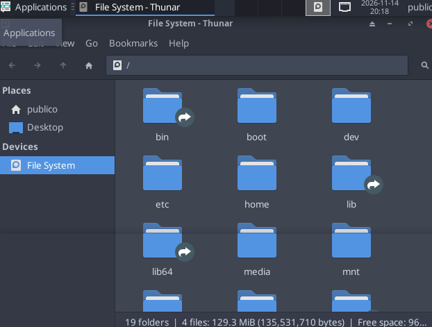
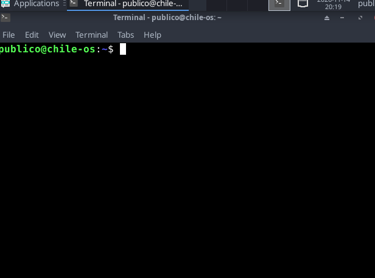

# 🇨🇱 Chile OS 2.0

# CHILE OS

### A Linux distribution built in Chile 🇨🇱

**Built in Chile. Powered by Linux.**

[Download Chile OS](https://drive.google.com/file/d/1GcjQSKjqAYi_yYJ4eN9NVT4Av6t0klOl/view?usp=sharing) · [GitHub Repository](https://github.com/chile-os/chile-os) · [Releases](https://github.com/chile-os/chile-os/releases)

---

## 📸 Screenshots

### 🖥️ Desktop Environment

### 📁 File Manager

### 💻 Terminal

---

## 🚀 About Chile OS

Chile OS is an independent Linux distribution created in Chile and based on Debian.

It uses the XFCE desktop environment to provide a simple and accessible desktop experience.

The project aims to create an independent Linux distribution with its own identity.

## ✨ Features

- 🇨🇱 Created in Chile.
- 🐧 Based on Debian.
- 🖥️ XFCE desktop environment.
- 🎨 Custom desktop experience.
- 💻 Linux-based operating system.
- 🌎 Independent open-source project.

## 📥 Download

### Chile OS 2.0 — Latest Version

<badge color="success">Latest release: v2.0</badge>

[⬇️ DOWNLOAD CHILE OS 2.0](https://drive.google.com/file/d/1GcjQSKjqAYi_yYJ4eN9NVT4Av6t0klOl/view?usp=sharing)

## 🛠️ Installation

1. Download the Chile OS ISO.
2. Open VirtualBox or another compatible virtualization program.
3. Create a new virtual machine.
4. Select the downloaded ISO.
5. Start the virtual machine.
6. Follow the installation instructions.

**Tip:** You can test Chile OS in a virtual machine before installing it on physical hardware.

## ⚙️ System Information

| Component | Details |
|---|---|
| Operating System | Chile OS |
| Version | 2.0 |
| Base | Debian |
| Desktop Environment | XFCE |
| Release Tag | v2.0 |
| Architecture | To be verified |

## 🗺️ Roadmap

- [ ] Improve the desktop experience.
- [ ] Develop Chile Store.
- [ ] Improve installation.
- [ ] Add more customization options.
- [ ] Improve hardware compatibility.
- [ ] Expand documentation.

## 🤝 Contributing

Contributions, suggestions, and bug reports are welcome!

You can help by:

- Testing Chile OS.
- Reporting bugs.
- Suggesting new features.
- Sharing the project.

## ⚠️ Disclaimer

Chile OS is an independent project based on Debian.

It is not an official Debian product and is not affiliated with or endorsed by the Debian Project.

Always back up important data before installing an operating system.

## 📜 License

See the repository's LICENSE file for licensing information.

## ❤️ Support Chile OS

If you like this project:

- ⭐ Star the repository.
- 📢 Share Chile OS.
- 🐛 Report bugs.
- 💡 Suggest improvements.

---

# 🇨🇱 CHILE OS 2.0

**Built in Chile. Powered by Linux
